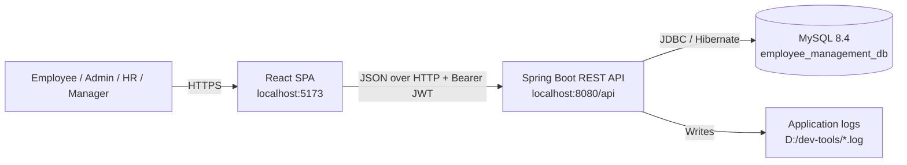
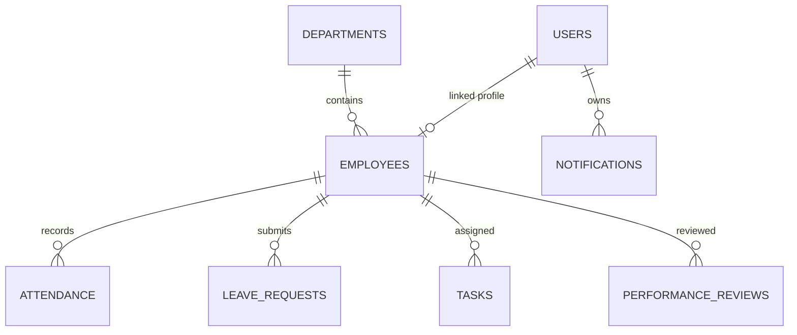

# Employee Management System (EMS)

A full-stack, role-based HR operations application: **Spring Boot 4 / Java 21** REST API, **React 19 + Vite** SPA, and **MySQL 8.4**.

It covers employee records, departments, attendance, leave lifecycle, task assignment, notifications, performance reviews, and role-specific dashboards.

> **System design and architecture:** [docs/ARCHITECTURE.md](docs/ARCHITECTURE.md)

---

## Contents

- [What it does](#what-it-does)
- [Technology stack](#technology-stack)
- [Quick start — Windows / VS Code](#quick-start--windows--vs-code)
- [Manual development setup](#manual-development-setup)
- [Project layout](#project-layout)
- [Architecture at a glance](#architecture-at-a-glance)
- [API quick reference](#api-quick-reference)
- [Data model](#data-model)
- [Configuration](#configuration)
- [Build and verification](#build-and-verification)
- [Troubleshooting](#troubleshooting)
- [Known limitations and roadmap](#known-limitations-and-roadmap)
- [Contributing](#contributing)

---

## What it does

### Employee-facing
- Apply for casual, sick, earned, unpaid, maternity, or paternity leave
- View leave balances and personal leave history
- Cancel pending leave requests
- Check in / check out and view attendance history
- View assigned tasks and move them `TODO → IN_PROGRESS → COMPLETED`
- Read notifications and mark them as read
- Update limited self-service profile fields

### Admin / HR / Manager-facing
- Search, filter, paginate, create, edit, and safely deactivate employees
- Create and list departments
- View all leave requests; **ADMIN/HR** can approve or reject pending requests through the API
- Create tasks and notify assignees
- Create and list performance reviews
- View aggregate dashboard metrics

### Roles

| Role | Primary scope |
|---|---|
| `ADMIN` | Full employee/department/leave/task/review administration |
| `HR` | Employee and leave administration; no department creation |
| `MANAGER` | Read directory, create tasks/reviews, view admin dashboard |
| `EMPLOYEE` | Self-service attendance, leave, tasks, profile, notifications |

Role checks are enforced server-side with Spring method security (`@PreAuthorize`). `hasRole('X')` is exact: an `ADMIN` cannot call an `EMPLOYEE`-only endpoint.

---

## Technology stack

| Layer | Technology | Notes |
|---|---|---|
| Frontend | React 19, React Router 7, Axios, Vite 8 | SPA served by Vite on port `5173` |
| Backend | Java 21, Spring Boot 4.1.1, Spring WebMVC | REST API on port `8080` |
| Security | Spring Security, JWT (jjwt 0.12.6), BCrypt | Stateless authentication, role claims |
| Persistence | Spring Data JPA, Hibernate, MySQL Connector/J | `ddl-auto=update`; no migration tool yet |
| Database | MySQL 8.4.9 | Local portable instance on port `3306` |
| Validation | Jakarta Bean Validation | DTO-level constraints |
| Build | Maven Wrapper, npm | `mvnw.cmd` and `npm run build` |
| Local runtime | PowerShell launcher | `run.ps1` / `run.cmd` |

---

## Quick start — Windows / VS Code

This repository is prepared for a **portable toolchain under `D:\dev-tools`**:

```text
D:\dev-tools\jdk-21.0.13.1+2
D:\dev-tools\mysql-8.4.9-winx64
```

### One-command start

From the repository root:

```powershell
# Option 1 — double-click this file in Explorer
run.cmd

# Option 2 — VS Code PowerShell terminal
.\run.ps1
```

The launcher is idempotent: it checks MySQL `3306`, backend `8080`, and UI `5173`, then starts only what is missing. It **will not start a second MySQL server** while one is already listening.

### Useful launcher commands

```powershell
.\run.ps1 -Build     # rebuild the backend jar, then start everything
.\run.ps1 -Stop      # stop backend + Vite; leave MySQL running
.\run.ps1 -StopAll   # stop backend + Vite and shut down MySQL gracefully
```

### Open the app

Open **<http://localhost:5173>**.

> Use `localhost`, not `127.0.0.1`. Backend CORS allows exactly `http://localhost:5173`.

### Local demo accounts

| Role | Email | Password |
|---|---|---|
| Admin | `admin@company.com` | `Admin@123` |
| Employee | `jane@company.com` | `Jane@123` |

### Runtime endpoints and logs

| Service | URL / path |
|---|---|
| UI | `http://localhost:5173` |
| API base | `http://localhost:8080/api` |
| Login API | `POST http://localhost:8080/api/auth/login` |
| Backend jar | `target\management-0.0.1-SNAPSHOT.jar` |
| Logs | `D:\dev-tools\mysql.log`, `backend.log`, `vite.log` (and matching `.err` files) |

The launcher loads `DB_PASSWORD` and `JWT_SECRET` from a gitignored `.env.local` file. Copy `.env.example` to `.env.local`, fill in your own values, and never commit that file.

---

## Manual development setup

Use this when you want separate VS Code terminals instead of the detached launcher.

### 1. Backend

```powershell
$env:JAVA_HOME = 'D:\dev-tools\jdk-21.0.13.1+2'
$env:PATH = "$env:JAVA_HOME\bin;$env:PATH"
$env:DB_PASSWORD = '<your-mysql-root-password>'
$env:JWT_SECRET = '<base64-encoded-secret>'

.\mvnw.cmd spring-boot:run
```

Required database:

```sql
CREATE DATABASE IF NOT EXISTS employee_management_db;
```

Hibernate creates and updates tables from the entity classes.

### 2. Frontend

```powershell
cd employee-management-ui
npm install
npm run dev -- --host 127.0.0.1
```

Then open <http://localhost:5173>.

> If the launcher is currently running detached services, stop them first with `.\run.ps1 -Stop` so the ports are free for your terminals.

### 3. Production-style build

```powershell
.\mvnw.cmd package -DskipTests
cd employee-management-ui
npm run build
```

The frontend production bundle is written to `employee-management-ui\dist`.

---

## Project layout

```text
employee-management-system-main/
├── src/main/java/com/employee/management/
│   ├── config/          # SecurityConfig, CORS, password encoder
│   ├── controller/      # 9 REST controllers under /api
│   ├── dto/             # Request/response contracts + ErrorResponseDto
│   ├── entity/          # JPA entities and domain enums
│   ├── exception/       # Custom exceptions + GlobalExceptionHandler
│   ├── mapper/          # EmployeeMapper
│   ├── repository/      # Spring Data JPA repositories
│   ├── security/        # JwtService, JwtAuthenticationFilter, UserDetailsService
│   ├── service/         # Service interfaces
│   ├── service/impl/    # Business rules and transactions
│   └── specification/   # Dynamic employee search criteria
├── src/main/resources/application.properties
├── employee-management-ui/
│   ├── src/
│   │   ├── components/  # Navbar shell
│   │   ├── context/     # AuthContext
│   │   ├── pages/       # Login, dashboard, employees, leave, etc.
│   │   ├── routes/      # ProtectedRoute, RoleProtectedRoute
│   │   ├── services/    # Axios API wrappers
│   │   └── index.css    # Global design system
│   └── dist/            # Built SPA
├── docs/ARCHITECTURE.md
├── run.ps1              # Idempotent local launcher
├── run.cmd              # Double-click wrapper
├── pom.xml
└── mvnw.cmd
```

---

## Architecture at a glance



- **Frontend**: route guards, role-aware navigation, Axios interceptor that attaches the JWT from `localStorage`.
- **Backend**: controller → DTO validation → service → repository → JPA → MySQL.
- **Cross-cutting**: JWT filter, `@PreAuthorize`, BCrypt, global exception mapping.
- **Runtime**: three processes orchestrated by `run.ps1`.

Full diagrams, sequence flows, ERD, role matrix, and design decisions are in **[docs/ARCHITECTURE.md](docs/ARCHITECTURE.md)**.

---

## API quick reference

All endpoints are prefixed with `/api`. Except `/api/auth/**`, every request requires:

```http
Authorization: Bearer <token>
```

| Area | Endpoints | Roles |
|---|---|---|
| Auth | `POST /auth/register`, `POST /auth/login` | Public |
| Employees | `POST /employees`, `PUT /employees/{id}`, `PATCH /employees/{id}/deactivate` | ADMIN, HR |
| Employees | `GET /employees`, `GET /employees/{id}` | ADMIN, HR, MANAGER |
| Employees | `GET /employees/me`, `PUT /employees/me` | EMPLOYEE |
| Departments | `POST /departments` | ADMIN |
| Departments | `GET /departments`, `GET /departments/{id}` | ADMIN, HR, MANAGER |
| Attendance | `POST /attendance/check-in`, `POST /attendance/check-out`, `GET /attendance/my-history` | EMPLOYEE |
| Leaves | `POST /leaves`, `GET /leaves/my`, `GET /leaves/my-balance`, `PATCH /leaves/{id}/cancel` | EMPLOYEE |
| Leaves | `GET /leaves`, `PATCH /leaves/{id}/approve`, `PATCH /leaves/{id}/reject` | ADMIN, HR |
| Tasks | `POST /tasks`, `GET /tasks` | ADMIN, HR, MANAGER |
| Tasks | `GET /tasks/my`, `PATCH /tasks/{id}/status` | EMPLOYEE |
| Notifications | `GET /notifications`, `PATCH /notifications/{id}/read`, `PATCH /notifications/read-all` | Any authenticated user |
| Dashboard | `GET /dashboard/admin` | ADMIN, HR, MANAGER |
| Dashboard | `GET /dashboard/employee` | EMPLOYEE |
| Performance | `POST /performance`, `GET /performance` | ADMIN, HR, MANAGER |
| Performance | `GET /performance/my` | EMPLOYEE |

Employee search supports `keyword`, `department`, `status`, and standard Spring `Pageable` parameters:

```http
GET /api/employees?keyword=jane&department=Engineering&status=ACTIVE&page=0&size=10&sort=id,asc
```

Validation and domain errors use `ErrorResponseDto`:

```json
{
  "timestamp": "2026-11-26T10:15:30Z",
  "status": 409,
  "error": "Conflict",
  "message": "Email already exists",
  "path": "/api/auth/register"
}
```

The complete endpoint catalog and error map are in [docs/ARCHITECTURE.md](docs/ARCHITECTURE.md#9-rest-api-surface).

---

## Data model



| Table | Purpose |
|---|---|
| `users` | Login identity, BCrypt password, role, enabled flag |
| `employees` | HR profile, status, department, optional one-to-one user link |
| `departments` | Organizational units |
| `attendance` | Daily check-in/out and derived status |
| `leave_requests` | Leave lifecycle and approval audit fields |
| `tasks` | Assignment, priority, status, due date |
| `notifications` | User-scoped messages and read state |
| `performance_reviews` | Ratings and review text |

No rows are hard-deleted by the application. Employee removal is implemented as **deactivation**: `status = INACTIVE` plus `users.enabled = false`, preserving history.

---

## Configuration

| Key / variable | Default in local launcher | Purpose |
|---|---|---|
| `spring.datasource.url` | `jdbc:mysql://localhost:3306/employee_management_db` | JDBC URL |
| `spring.datasource.username` | `root` | DB user |
| `DB_PASSWORD` | from `.env.local` | DB password (required env var) |
| `JWT_SECRET` | from `.env.local` | Base64 HMAC secret (required env var) |
| `jwt.expiration` | `86400000` | Token lifetime, 24 hours |
| `spring.jpa.hibernate.ddl-auto` | `update` | Schema generation strategy |
| `spring.jpa.show-sql` | `true` | SQL logging |
| Frontend API base URL | `http://localhost:8080/api` | `employee-management-ui/src/services/api.js` |
| Allowed CORS origin | `http://localhost:5173` | `SecurityConfig.java` |

For deployment outside this local setup, move `DB_PASSWORD`, `JWT_SECRET`, the CORS origin, and the API base URL into environment-specific configuration. Do not hardcode production secrets.

---

## Build and verification

```powershell
# Backend compile + package
.\mvnw.cmd clean package -DskipTests

# Backend tests
.\mvnw.cmd test

# Frontend lint + production build
cd employee-management-ui
npm run lint
npm run build
```

Smoke check after `.\run.ps1`:

```powershell
curl.exe -sS -o NUL -w "UI %{http_code}`n" http://localhost:5173/

$login = Invoke-RestMethod -Method Post `
  -Uri 'http://localhost:8080/api/auth/login' `
  -ContentType 'application/json' `
  -Body '{"email":"admin@company.com","password":"Admin@123"}'

"Login role: $($login.role)"
```

---

## Troubleshooting

| Symptom | Cause | Fix |
|---|---|---|
| CORS error in browser | App opened at `http://127.0.0.1:5173` | Open `http://localhost:5173` instead |
| `The innodb_system data file 'ibdata1' must be writable` | A second `mysqld` tried to use a locked data directory | Use the existing MySQL on `3306`; do not launch another copy |
| Port `8080` or `5173` already in use | Detached or terminal-run service still active | Run `.\run.ps1 -Stop`, then start again |
| Backend fails with missing env var | `DB_PASSWORD` / `JWT_SECRET` not set | Use `run.ps1` or set both variables before Maven |
| `java version` mismatch | Another JDK is first on `PATH` | Use the provided JDK 21 or prepend `D:\dev-tools\jdk-21.0.13.1+2\bin` |
| Vite dependency error | `node_modules` missing or stale | Delete `employee-management-ui\node_modules` and run `npm install` |
| Login works but page shows 403 | Role lacks permission for that endpoint | Check the role matrix above |
| Admin cannot approve leave in UI | UI approval page is not implemented yet | Use `PATCH /api/leaves/{id}/approve`, or add the page described in the roadmap |

---

## Known limitations and roadmap

The app is functional for local development, but it is not production-hardened yet.

### Current limitations
- Public `/api/auth/register` allows self-registration of `ADMIN` / `HR` / `MANAGER` roles; local bootstrap relies on this.
- `spring.jpa.hibernate.ddl-auto=update`; no Flyway/Liquibase migrations.
- `run.ps1` hardcodes local portable tool paths; secrets come from gitignored `.env.local`.
- JWTs are not revoked when an employee is deactivated; existing tokens remain valid until expiry.
- No refresh-token flow, token revocation list, or global `401` interceptor.
- No explicit service-level `@Transactional`; multi-step operations are not atomic as a unit.
- Admin leave approval exists in the API but has no UI; the admin dashboard only shows a pending count.
- Only the employee list is paginated; several list endpoints are unbounded.
- No database unique constraint on `(employee_id, date)` for attendance; enforced only in the service layer.
- Validation errors return a different JSON shape from `ErrorResponseDto`.
- Only a `contextLoads()` test exists; no controller/service integration tests.
- CORS origin and frontend API URL are hardcoded to local development.

### Suggested next steps
1. Add an **Admin Leave Approvals** page and nav entry for `ADMIN`/`HR`.
2. Introduce Flyway/Liquibase migrations and replace `ddl-auto=update`.
3. Use a secret manager in production and move CORS/API URLs into environment profiles.
4. Add JWT revocation or short-lived access tokens with refresh tokens.
5. Add integration tests for auth, leave lifecycle, deactivation, and role access.
6. Add pagination to leaves, tasks, departments, and performance reviews.
7. Add a global API error interceptor for `401`/`403` handling.

---

## Contributing

- Work from `main` or a feature branch; keep local uncommitted work intact.
- Backend convention: **controller → service interface → service impl → repository**, with DTOs at the boundaries.
- Frontend convention: **page → service wrapper → shared Axios instance**; keep business rules on the server.
- Add validation to request DTOs and domain errors to `GlobalExceptionHandler`.
- Before opening a PR: run `mvnw.cmd test` and `npm run lint && npm run build`.
- Update [docs/ARCHITECTURE.md](docs/ARCHITECTURE.md) whenever a component, endpoint, role rule, or data relationship changes.
