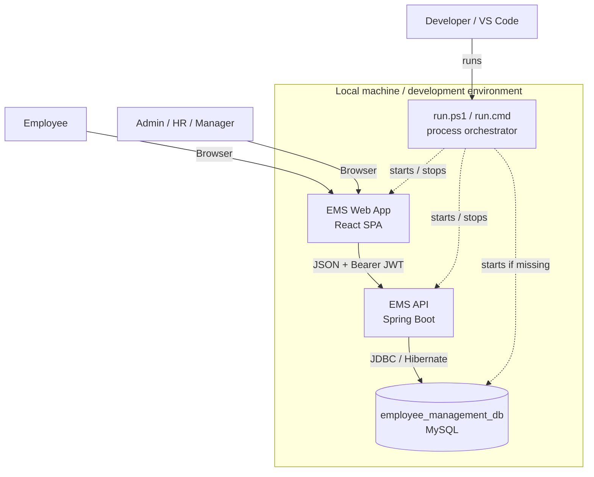
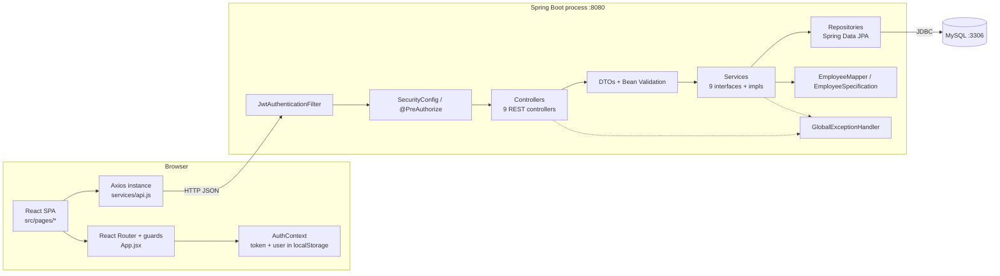
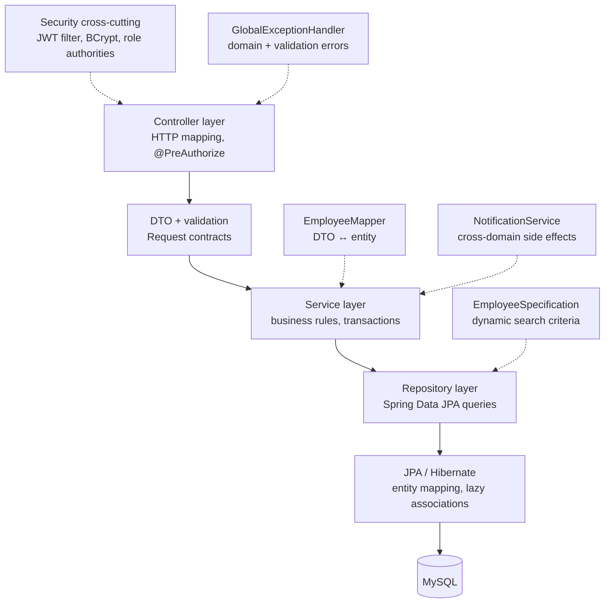
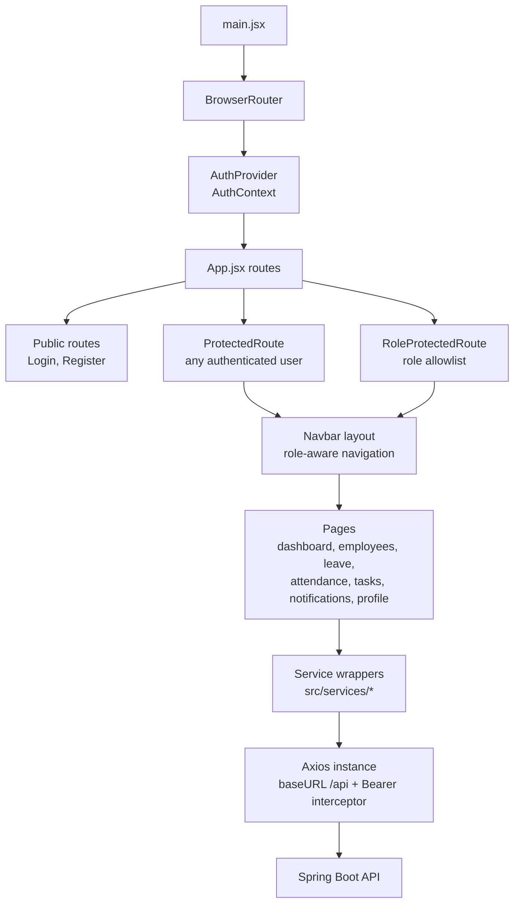
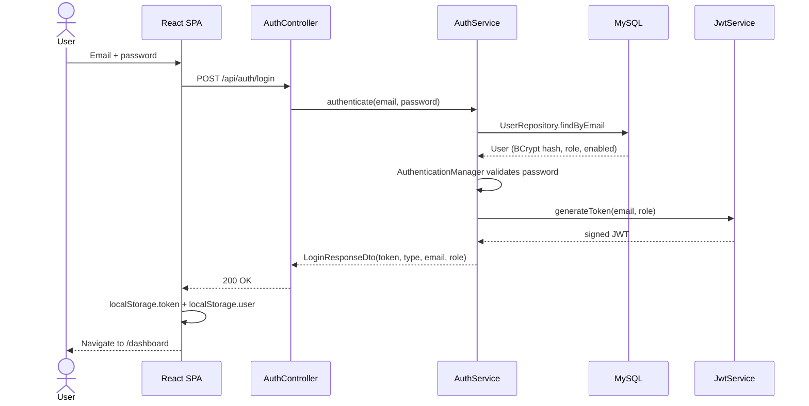
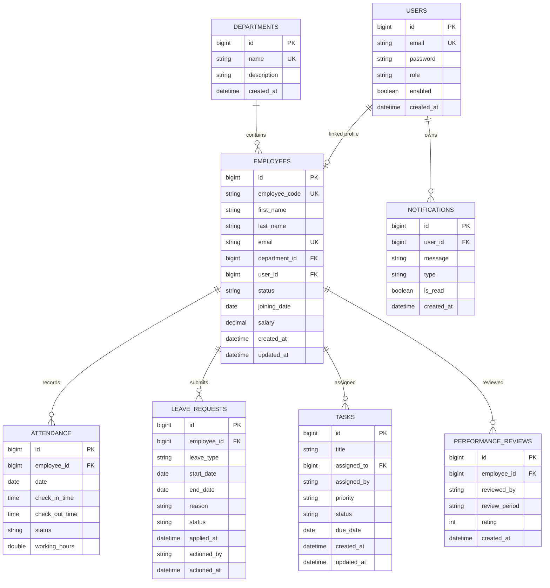
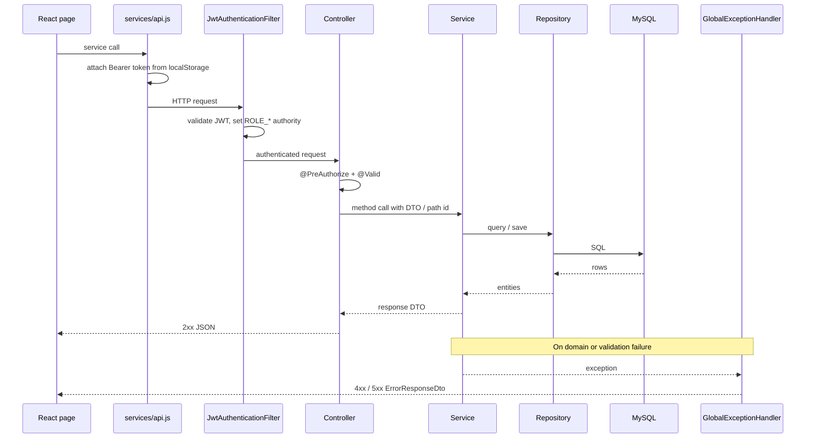
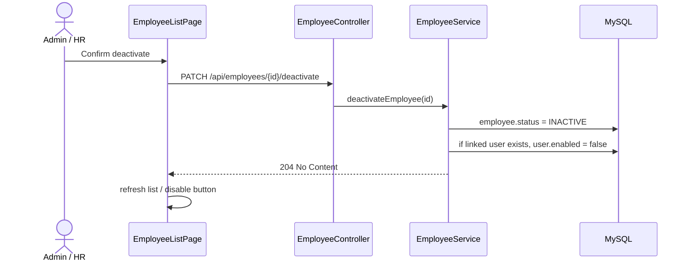
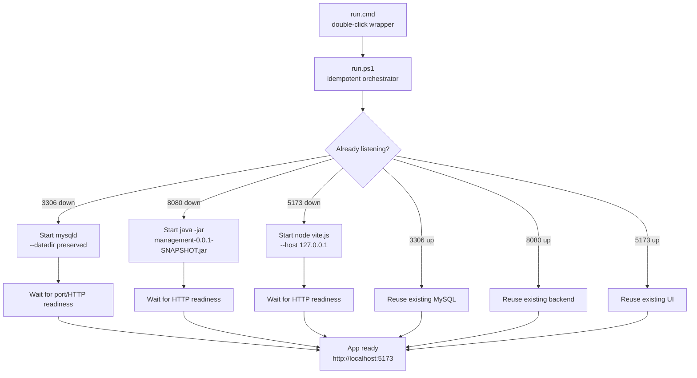

# Employee Management System — System Design & Architecture

**Status:** Current implementation (as of 2026-11-26)  
**Repository:** `employee-management-system-main`  
**Audience:** Developers, reviewers, and anyone maintaining or extending the system

This document describes how the system is actually built today, not an idealized target state. It covers runtime topology, layers, domain model, request flows, authorization, configuration, known gaps, and an evolution path.

---

## 1. Purpose and scope

EMS is a role-based HR operations platform. It manages:

- identity and access (users, JWT, roles)
- employee master data and departments
- attendance
- leave requests and approvals
- task assignment and status transitions
- notifications
- performance reviews
- role-specific dashboards

The system is split into two independently runnable applications backed by one MySQL database:

| Module | Technology | Port |
|---|---|---:|
| Browser SPA | React 19 + Vite 8 | `5173` |
| REST API | Spring Boot 4.1.1 / Java 21 | `8080` |
| Database | MySQL 8.4.9 | `3306` |

A PowerShell launcher (`run.ps1`) orchestrates all three processes on the local Windows development machine.

---

## 2. System context (C4 level 1)



### External interactions

| Actor | Interaction |
|---|---|
| Employee | Applies for leave, checks in/out, views tasks, updates limited profile fields |
| Admin / HR | Manages employees, departments, leave approvals, tasks, reviews |
| Manager | Reads directory, creates tasks and reviews, views admin dashboard |
| Developer | Runs the launcher, reads logs, inspects MySQL |

There are no third-party integrations, message brokers, caches, email providers, or object stores in the current implementation.

---

## 3. Container view (C4 level 2)



### Container responsibilities

| Container | Responsibility | Key implementation |
|---|---|---|
| React SPA | Render role-aware UI, collect input, hold auth state locally | `employee-management-ui/src` |
| Spring Boot API | Enforce security, validate input, implement business rules, persist data | `src/main/java/com/employee/management` |
| MySQL | Store relational HR data | `employee_management_db` |
| Launcher | Start missing services, wait for readiness, centralize logs | `run.ps1`, `run.cmd` |

---

## 4. Backend layered architecture



### Layer rules

1. **Controllers** only translate HTTP ↔ DTOs and declare authorization. They contain no business rules.
2. **DTOs** define the external contract. Entities are never returned directly.
3. **Services** own business rules, validation of state transitions, and side effects such as notifications.
4. **Repositories** own persistence queries. Complex filtering is expressed with `EmployeeSpecification`.
5. **Entities** map to tables. Associations are `LAZY`; enums are stored as strings.

### Backend packages

| Package | Contents |
|---|---|
| `config` | `SecurityConfig`, CORS, password encoder, authentication manager |
| `controller` | `Auth`, `Employee`, `Department`, `Attendance`, `Leave`, `Task`, `Notification`, `Dashboard`, `PerformanceReview` controllers |
| `dto` | 24 request/response contracts including `ErrorResponseDto` |
| `entity` | 8 JPA entities and 8 domain enums |
| `exception` | 12 domain exceptions + `GlobalExceptionHandler` |
| `mapper` | `EmployeeMapper` |
| `repository` | 8 Spring Data repositories |
| `security` | `JwtService`, `JwtAuthenticationFilter`, `CustomUserDetailsService` |
| `service` / `service.impl` | 9 service interfaces and their implementations |
| `specification` | Dynamic employee search with JPA Criteria |

---

## 5. Frontend architecture



### Frontend design decisions

- **Auth state is client-side**: `token` and `user` are stored in `localStorage` by `AuthContext`.
- **Route guards are UX guards only**: real authorization is enforced by `@PreAuthorize` on the server.
- **Navigation is role-aware**: EMPLOYEE links differ from ADMIN/HR/MANAGER links.
- **One Axios instance**: all API calls go through `services/api.js`, which injects the JWT.
- **Global CSS design system**: `src/index.css` defines variables for colors, spacing, cards, tables, badges, modals, and responsive layout.

### Current frontend gaps

The following backend capabilities have **no UI implementation yet**:

- `GET /api/leaves` and `PATCH /api/leaves/{id}/approve|reject`
- `POST /api/tasks` and `GET /api/tasks`
- all `/api/performance` endpoints
- `GET /api/employees/{id}` and `GET /api/departments/{id}`

There is also no global `401` interceptor; pages handle errors locally.

---

## 6. Authentication and authorization

### 6.1 Login flow



### 6.2 Request authentication

1. Axios reads `token` from `localStorage` and sends `Authorization: Bearer <token>`.
2. `JwtAuthenticationFilter` parses and validates the signature and expiry.
3. It builds a `ROLE_<role>` authority from the token's `role` claim.
4. `SecurityConfig` requires authentication for every route except `/api/auth/**`.
5. `@PreAuthorize` on controllers enforces endpoint-level role rules.

### 6.3 Important security characteristics

| Characteristic | Current behavior |
|---|---|
| Password storage | BCrypt |
| Token algorithm | HMAC using `Keys.hmacShaKeyFor(Base64.decode(jwt.secret))` |
| Token lifetime | `86400000` ms = 24 hours |
| Session state | Stateless; no HTTP session |
| Authority source | JWT claim only; no database lookup per request |
| Deactivation effect | `users.enabled=false` blocks **new logins**, but existing JWTs remain valid until expiry |
| CSRF | Disabled, appropriate for stateless bearer-token API |
| CORS | Exactly `http://localhost:5173`, credentials allowed |
| Registration | `/api/auth/register` is public and accepts any role |

> **Security note:** public self-registration of privileged roles is acceptable only for local bootstrap. It must be replaced with an invite/approval workflow before production use.

### 6.4 Role matrix

| Area | ADMIN | HR | MANAGER | EMPLOYEE | Public |
|---|:---:|:---:|:---:|:---:|:---:|
| Register / login | ✓ | ✓ | ✓ | ✓ | ✓ |
| Create employee | ✓ | ✓ | — | — | — |
| List / get employee | ✓ | ✓ | ✓ | — | — |
| Update / deactivate employee | ✓ | ✓ | — | — | — |
| Self profile | — | — | — | ✓ | — |
| Create department | ✓ | — | — | — | — |
| List / get department | ✓ | ✓ | ✓ | — | — |
| Attendance | — | — | — | ✓ | — |
| Apply / cancel own leave | — | — | — | ✓ | — |
| List all leaves | ✓ | ✓ | — | — | — |
| Approve / reject leave | ✓ | ✓ | — | — | — |
| Create / list tasks | ✓ | ✓ | ✓ | — | — |
| My tasks / update status | — | — | — | ✓ | — |
| Notifications | ✓ | ✓ | ✓ | ✓ | — |
| Admin dashboard | ✓ | ✓ | ✓ | — | — |
| Employee dashboard | — | — | — | ✓ | — |
| Create / list reviews | ✓ | ✓ | ✓ | — | — |
| My reviews | — | — | — | ✓ | — |

`hasRole('X')` is exact, so an `ADMIN` cannot call an `EMPLOYEE`-only endpoint even though it has more privileges semantically.

---

## 7. Domain model and data design

### 7.1 ER diagram



### 7.2 Table summary

| Table | Entity | Notes |
|---|---|---|
| `users` | `User` | Identity, BCrypt password, role, `enabled`; unique email |
| `employees` | `Employee` | HR profile; unique code and email; optional unique `user_id` |
| `departments` | `Department` | Unique name |
| `attendance` | `Attendance` | One logical record per employee/day, enforced in service only |
| `leave_requests` | `Leave` | Status lifecycle and audit fields |
| `tasks` | `Task` | `assigned_by` is an email string, not a FK |
| `notifications` | `Notification` | User-scoped inbox |
| `performance_reviews` | `PerformanceReview` | `reviewed_by` is an email string, not a FK |

### 7.3 Enums

| Enum | Values |
|---|---|
| `Role` | ADMIN, HR, MANAGER, EMPLOYEE |
| `EmployeeStatus` | ACTIVE, INACTIVE, ON_NOTICE, RESIGNED, TERMINATED |
| `AttendanceStatus` | PRESENT, ABSENT, HALF_DAY, LATE |
| `LeaveType` | CASUAL, SICK, EARNED, UNPAID, MATERNITY, PATERNITY |
| `LeaveStatus` | PENDING, APPROVED, REJECTED, CANCELLED |
| `TaskPriority` | LOW, MEDIUM, HIGH, URGENT |
| `TaskStatus` | TODO, IN_PROGRESS, COMPLETED, CANCELLED |
| `NotificationType` | LEAVE_APPROVED, LEAVE_REJECTED, TASK_ASSIGNED, SYSTEM |

### 7.4 Data design observations

- All IDs use `GenerationType.IDENTITY`.
- All associations are `LAZY`; DTO mapping avoids serializing entity graphs.
- No cascade or orphan removal is configured; persistence is managed explicitly in services.
- `assignedBy`, `actionedBy`, and `reviewedBy` are plain email strings. This preserves an audit trail even if a user row disappears, but gives up referential integrity.
- Deactivation is a **soft removal**: no `DELETE` endpoints exist anywhere.
- Schema is created/updated by Hibernate (`ddl-auto=update`). There are no migration scripts checked in.

---

## 8. Core business flows

### 8.1 Generic authenticated request



### 8.2 Leave application and approval

```mermaid
sequenceDiagram
    actor E as Employee
    actor A as Admin / HR
    participant UI as React SPA
    participant API as Spring API
    participant LS as LeaveService
    participant DB as MySQL
    participant NS as NotificationService

    E->>UI: Apply (type, dates, reason)
    UI->>API: POST /api/leaves
    API->>LS: applyLeave(email, dto)
    LS->>DB: check overlapping PENDING/APPROVED leaves
    LS->>DB: check annual quota (CASUAL 12, SICK 10, EARNED 15)
    LS->>DB: save Leave(status=PENDING)
    LS-->>UI: 201 LeaveResponseDto

    Note over UI,API: Current UI has no approval button; admin uses the API directly.
    A->>API: GET /api/leaves
    API-->>A: all leave requests
    A->>API: PATCH /api/leaves/{id}/approve
    API->>LS: approveLeave(id, adminEmail)
    LS->>DB: load leave, require status=PENDING
    LS->>DB: status=APPROVED, actionedBy, actionedAt
    LS->>NS: notify employee
    NS->>DB: save Notification(LEAVE_APPROVED)
    LS-->>A: 200 LeaveResponseDto
```

**Rules enforced by `LeaveServiceImpl`:**

- End date cannot be before start date.
- Overlap is rejected against existing `PENDING` or `APPROVED` leaves using inclusive boundaries.
- Annual quota is checked for `CASUAL`, `SICK`, and `EARNED`; other leave types have no quota.
- Inclusive day count = `DAYS.between(start, end) + 1`.
- Used days count only `APPROVED` leaves whose **start date** is in the current year.
- Approve/reject is only valid from `PENDING`.
- Approval and rejection write `actionedBy` and `actionedAt`, then create a notification.
- Employees may cancel only their own `PENDING` leaves; no notification is created on cancellation.

### 8.3 Employee deactivation



Historical attendance, leave, task, and review rows remain intact. There is no reactivation endpoint.

### 8.4 Attendance check-in / check-out

1. Identity is resolved by `email → User → Employee`.
2. Check-in creates one record for the day; a duplicate returns `409`.
3. Check-out updates the same record; missing check-in returns `400`; duplicate check-out returns `409`.
4. `workingHours = durationMinutes / 60`, rounded to two decimals.
5. Status is derived: `< 4h → HALF_DAY`, else check-in after `10:00 → LATE`, else `PRESENT`.
6. `ABSENT` is defined but not assigned automatically.

### 8.5 Dashboard aggregation

| Admin dashboard metric | Source |
|---|---|
| Total employees | `EmployeeRepository.count()` |
| Active employees | `EmployeeRepository.countByStatus(ACTIVE)` |
| Departments | `DepartmentRepository.count()` |
| On leave today | JPQL: distinct employees with `APPROVED` leave spanning today |
| Today's attendance | `AttendanceRepository.countByDate(today)` |
| Pending leave requests | `LeaveRepository.countByStatus(PENDING)` |
| Recent employees | `EmployeeRepository.findTop5ByOrderByCreatedAtDesc()` |

| Employee dashboard metric | Source |
|---|---|
| Check-in/out today | `AttendanceRepository.findByEmployeeIdAndDate` |
| Leave balances | `LeaveService.getMyLeaveBalance` |
| Pending leave count | approved/pending leave queries |
| Task counts | `TaskRepository.countByAssignedToId*` |
| Unread notifications | `NotificationRepository.countByUserIdAndIsReadFalse` |

---

## 9. REST API surface

All routes are prefixed with `/api`. Except `/api/auth/**`, every route requires `Authorization: Bearer <token>`.

### 9.1 Auth

| Method | Path | Roles | Result |
|---|---|---|---|
| POST | `/auth/register` | Public | 201 `RegisterResponseDto` |
| POST | `/auth/login` | Public | 200 `LoginResponseDto` |

### 9.2 Employees and departments

| Method | Path | Roles | Notes |
|---|---|---|---|
| POST | `/employees` | ADMIN, HR | 201; creates profile and optional user link |
| GET | `/employees` | ADMIN, HR, MANAGER | `keyword`, `department`, `status`, `Pageable`; default size 10 |
| GET | `/employees/{id}` | ADMIN, HR, MANAGER | 200 profile |
| PUT | `/employees/{id}` | ADMIN, HR | Email and employee code are intentionally immutable |
| PATCH | `/employees/{id}/deactivate` | ADMIN, HR | 204; status `INACTIVE` + user disabled |
| GET | `/employees/me` | EMPLOYEE | Own profile |
| PUT | `/employees/me` | EMPLOYEE | Phone, address, gender, DOB only |
| POST | `/departments` | ADMIN | 201 |
| GET | `/departments` | ADMIN, HR, MANAGER | List |
| GET | `/departments/{id}` | ADMIN, HR, MANAGER | Single department |

### 9.3 Attendance and leave

| Method | Path | Roles | Notes |
|---|---|---|---|
| POST | `/attendance/check-in` | EMPLOYEE | 201 |
| POST | `/attendance/check-out` | EMPLOYEE | 200 |
| GET | `/attendance/my-history` | EMPLOYEE | Date descending |
| POST | `/leaves` | EMPLOYEE | 201; starts `PENDING` |
| GET | `/leaves/my` | EMPLOYEE | Own leaves, newest first |
| GET | `/leaves/my-balance` | EMPLOYEE | Quota / used / remaining |
| PATCH | `/leaves/{id}/cancel` | EMPLOYEE | Own pending leaves only |
| GET | `/leaves` | ADMIN, HR | All leaves, newest first |
| PATCH | `/leaves/{id}/approve` | ADMIN, HR | Pending → Approved + notification |
| PATCH | `/leaves/{id}/reject` | ADMIN, HR | Pending → Rejected + notification |

### 9.4 Tasks, notifications, dashboards, performance

| Method | Path | Roles | Notes |
|---|---|---|---|
| POST | `/tasks` | ADMIN, HR, MANAGER | Creates task + assignee notification |
| GET | `/tasks` | ADMIN, HR, MANAGER | All tasks, newest first |
| GET | `/tasks/my` | EMPLOYEE | Due date ascending |
| PATCH | `/tasks/{id}/status` | EMPLOYEE | `TODO → IN_PROGRESS → COMPLETED` |
| GET | `/notifications` | Any authenticated user | Own notifications, newest first |
| PATCH | `/notifications/{id}/read` | Any authenticated user | Ownership enforced in service |
| PATCH | `/notifications/read-all` | Any authenticated user | 204 |
| GET | `/dashboard/admin` | ADMIN, HR, MANAGER | Aggregate metrics |
| GET | `/dashboard/employee` | EMPLOYEE | Personal metrics |
| POST | `/performance` | ADMIN, HR, MANAGER | 201 |
| GET | `/performance` | ADMIN, HR, MANAGER | All reviews |
| GET | `/performance/my` | EMPLOYEE | Own reviews |

### 9.5 Error model

`GlobalExceptionHandler` returns `ErrorResponseDto` for most failures:

```json
{
  "timestamp": "2026-11-26T10:15:30Z",
  "status": 409,
  "error": "Conflict",
  "message": "Email already exists",
  "path": "/api/auth/register"
}
```

| Exception family | HTTP |
|---|---:|
| `EmployeeNotFoundException`, `DepartmentNotFoundException`, `EmployeeProfileNotLinkedException`, `LeaveNotFoundException`, `TaskNotFoundException` | 404 |
| `DuplicateEmailException`, `UserAlreadyExistsException`, `AlreadyCheckedInException`, `AlreadyCheckedOutException` | 409 |
| `InvalidLeaveException`, `InvalidTaskStatusException`, `NotCheckedInException`, `IllegalArgumentException` | 400 |
| `AuthenticationException` | 401 |
| `AccessDeniedException` | 403 |
| Unexpected `Exception` | 500 |
| `MethodArgumentNotValidException` | 400 with `Map<field, message>` — different shape |

---

## 10. Configuration and environment

### 10.1 Backend — `src/main/resources/application.properties`

| Key | Value | Notes |
|---|---|---|
| `spring.application.name` | `management` | App name |
| `spring.datasource.url` | `jdbc:mysql://localhost:3306/employee_management_db` | JDBC URL |
| `spring.datasource.username` | `root` | Local DB user |
| `spring.datasource.password` | `${DB_PASSWORD}` | Required env var |
| `spring.jpa.hibernate.ddl-auto` | `update` | Dev-only schema strategy |
| `spring.jpa.show-sql` | `true` | SQL logging |
| `spring.jpa.properties.hibernate.dialect` | `org.hibernate.dialect.MySQLDialect` | Hibernate dialect |
| `jwt.secret` | `${JWT_SECRET}` | Required Base64 env var |
| `jwt.expiration` | `86400000` | 24 hours |

### 10.2 Frontend

| Setting | Value | Source |
|---|---|---|
| API base URL | `http://localhost:8080/api` | `src/services/api.js` |
| Auth storage keys | `token`, `user` | `AuthContext.jsx`, `api.js` |
| Dev server bind | `127.0.0.1` via launcher | `run.ps1` starts `vite.js --host 127.0.0.1` |
| Public origin used in browser | `http://localhost:5173` | Required by CORS |

### 10.3 Security configuration

| Setting | Value |
|---|---|
| CORS allowed origin | `http://localhost:5173` only |
| Allowed methods | GET, POST, PUT, PATCH, DELETE, OPTIONS |
| Allowed headers | `*` |
| Credentials | `true` |
| CSRF | Disabled |
| Session policy | STATELESS |
| Public routes | `/api/auth/**` |
| Auth entry point | HTTP 401 |

### 10.4 Local launcher

`run.ps1` hardcodes this local topology:

```text
JDK      D:\dev-tools\jdk-21.0.13.1+2
MySQL    D:\dev-tools\mysql-8.4.9-winx64
Data     D:\dev-tools\mysql-8.4.9-winx64\data
Env      .env.local (gitignored)
Jar      target\management-0.0.1-SNAPSHOT.jar
Vite     employee-management-ui\node_modules\vite\bin\vite.js
Logs     D:\dev-tools\*.log and *.err
```

It sets `JAVA_HOME`, loads `DB_PASSWORD` and `JWT_SECRET` from the gitignored `.env.local`, then starts MySQL → backend → frontend only when needed.

---

## 11. Local runtime topology



### Stop semantics

| Command | Effect |
|---|---|
| `.\run.ps1 -Stop` | Stops backend and Vite; leaves MySQL running |
| `.\run.ps1 -StopAll` | Stops backend and Vite; gracefully shuts down MySQL via `mysqladmin` |

The launcher never deletes `D:\dev-tools\mysql-8.4.9-winx64\data`.

---

## 12. Cross-cutting concerns

### Validation
- Jakarta Bean Validation annotations on request DTOs.
- `@Email`, `@NotBlank`, `@Past`, `@FutureOrPresent`, `@Positive`, `@Min`, `@Max`.
- Failures are handled globally.

### Exception handling
- 12 domain-specific exceptions plus Spring `AuthenticationException` and `AccessDeniedException`.
- Catch-all hides internal messages from clients.

### Search
- `EmployeeSpecification` builds JPA Criteria predicates.
- Keyword matches lowercase first name, last name, email, or employee code.
- Department filter is case-insensitive **exact name** match.
- Status filter is exact enum match.

### Logging
- `spring.jpa.show-sql=true` emits SQL statements to the backend log.
- Launcher redirects stdout/stderr to `D:\dev-tools\*.log` / `*.err`.
- No structured logging, correlation IDs, metrics endpoint, or distributed tracing.

### Transactions
- No `@Transactional` annotations are currently declared in the service layer.
- Individual Spring Data repository methods are transactional by default, but multi-step service operations are not automatically atomic as one unit.
- Repository saves are explicit; no cascading persistence is configured.
- Add explicit service-level transactions before handling concurrent or failure-sensitive workflows.

---

## 13. Non-functional assessment

| Concern | Current state | Assessment |
|---|---|---|
| Statelessness | JWT, no HTTP session | Backend can be horizontally scaled behind a load balancer |
| Portability | Portable JDK/MySQL + launcher | Excellent for this local Windows setup; hardcoded paths otherwise |
| Security | BCrypt + JWT + method security | Good baseline; bootstrap/revocation need work |
| Data integrity | Unique constraints on natural keys | Good; attendance uniqueness missing at DB level |
| Performance | Lazy associations, DTO projection, employee pagination | Fine for dev/small teams; list endpoints unbounded |
| Observability | Log files + SQL logging | Minimal; no metrics or tracing |
| Testability | One `contextLoads()` test | Insufficient; add service/controller integration tests |
| Deployability | Three manual processes | Local launcher works; containerization recommended |
| Maintainability | Clear layering and naming | Strong; docs and tests need investment |

---

## 14. Known technical debt

| Priority | Item | Impact |
|---|---|---|
| High | Public privileged registration | Anyone can create an ADMIN account |
| High | Secrets stored in local `.env.local` only | No secret manager or rotation for shared/production environments |
| High | `ddl-auto=update` | Schema changes are implicit and not reviewable |
| High | JWT not revoked on deactivation | Disabled user's existing token still works until expiry |
| Medium | No admin leave approval UI | Approvals require direct API calls |
| Medium | No global 401 interceptor | Expired tokens do not consistently clear session/navigate to login |
| Medium | No explicit service transactions | Multi-step service operations are not atomic as a unit |
| Medium | Only one test | Regressions are likely during feature work |
| Medium | CORS/API URL hardcoded | Environment promotion requires code edits |
| Low | Attendance unique constraint only in service | Concurrent duplicate check-in could race |
| Low | Validation error shape differs | Frontend must handle two error contracts |
| Low | No catch-all frontend route | Unknown URLs render nothing meaningful |
| Low | Audit actor fields are strings | No FK integrity for `actionedBy` / `assignedBy` / `reviewedBy` |

---

## 15. Evolution roadmap

### Phase 1 — Make it safe to share
1. Replace public privileged registration with invite/approval or an initial-admin-only bootstrap.
2. Use a secret manager in production and move CORS/API URLs into environment profiles.
3. Add Flyway or Liquibase migrations and switch `ddl-auto` to `validate`.
4. Add JWT revocation or short-lived access tokens plus refresh tokens.

### Phase 2 — Complete the product surface
1. Add the Admin Leave Approvals page with `GET /leaves`, approve, and reject actions.
2. Add task creation/list UI for ADMIN/HR/MANAGER.
3. Add performance review UI.
4. Add global `401`/`403` handling in Axios.

### Phase 3 — Harden and scale
1. Add integration tests with Testcontainers MySQL.
2. Add pagination to all list endpoints.
3. Add a DB unique constraint on `(employee_id, date)` for attendance.
4. Add structured logging, health endpoint, and metrics.
5. Add Docker Compose for one-command multi-machine startup.
6. Add API versioning (`/api/v1`) before external consumers appear.

---

## 16. Design decision log

| Decision | Rationale | Trade-off |
|---|---|---|
| JWT stateless auth | Simple API scaling; no server-side session store | Revocation requires extra machinery |
| Spring Data JPA + Hibernate | Fast CRUD development and dynamic criteria queries | Less explicit SQL control; `ddl-auto` is risky in production |
| DTO boundary | Avoids leaking entities and lazy-loading surprises | More mapping code |
| Soft employee deactivation | Preserves HR history and avoids destructive deletes | Requires explicit reactivation workflow later |
| Email strings for actor fields | Keeps audit trail even if users change | No referential integrity |
| Vite + Axios SPA | Fast local development and simple API integration | CORS origin must be configured explicitly |
| PowerShell launcher | Single-entry local runtime for non-admin Windows users | Hardcoded tool paths; local env file for secrets |
| Method-level `@PreAuthorize` | Authorization lives next to endpoint definitions | Role matrix must be kept in sync manually |

---

## 17. Quick reference for maintainers

| Need | Look here |
|---|---|
| Add an endpoint | `controller` → `service` → `service.impl` → `repository` |
| Change role rules | Controller `@PreAuthorize` and this document's role matrix |
| Change validation | Request DTO annotations |
| Change business rules | Relevant `service.impl` class |
| Change schema | Entity class, then add a migration once Flyway/Liquibase is introduced |
| Change API URL | `employee-management-ui/src/services/api.js` |
| Change CORS | `config/SecurityConfig.java` |
| Change local startup | `run.ps1` |
| Understand runtime logs | `D:\dev-tools\*.log` / `*.err` |
